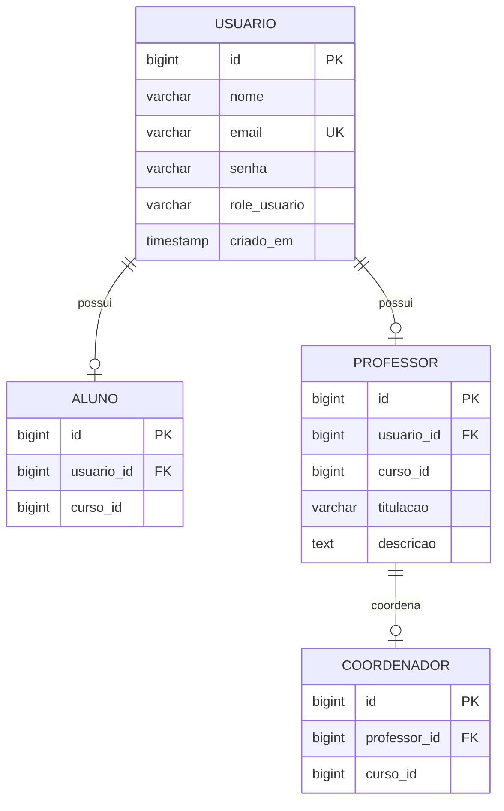

# 🎓 Portal TADS — Microsserviço de Usuários (`usuarioService`)

[](https://www.oracle.com/java/)
[](https://spring.io/projects/spring-boot)
[](https://spring.io/projects/spring-security)
[](https://www.postgresql.org/)
[](https://flywaydb.org/)
[](https://swagger.io/)

Microsserviço de autenticação, autorização e gerenciamento de perfis de usuários do ecossistema educacional **Portal TADS**.

---

## 📑 Sumário

- [Visão Geral](#-visão-geral)
- [Arquitetura e Modelagem](#-arquitetura-e-modelagem)
  - [Fluxo de Requisições](#fluxo-de-requisições)
  - [Modelo Relacional de Dados](#modelo-relacional-de-dados)
- [Tecnologias Utilizadas](#-tecnologias-utilizadas)
- [Estrutura do Projeto](#-estrutura-do-projeto)
- [Variáveis de Ambiente (.env)](#-variáveis-de-ambiente-env)
- [Como Rodar a Aplicação](#-como-rodar-a-aplicação)
  - [1. Pré-requisitos](#1-pré-requisitos)
  - [2. Configurar o Banco de Dados (PostgreSQL)](#2-configurar-o-banco-de-dados-postgresql)
  - [3. Configurar o Arquivo de Ambiente](#3-configurar-o-arquivo-de-ambiente)
  - [4. Executar o Microsserviço](#4-executar-o-microsserviço)
- [Documentação da API (Swagger UI)](#-documentação-da-api-swagger-ui)
- [Endpoints Principais da API](#-endpoints-principais-da-api)
  - [Exemplos de Requisições (cURL)](#exemplos-de-requisições-curl)
- [Usuários de Teste (Seeder)](#-usuários-de-teste-seeder)
- [Tratamento de Erros](#-tratamento-de-erros)
- [Comandos Úteis de Desenvolvimento](#-comandos-úteis-de-desenvolvimento)

---

## 🎯 Visão Geral

O **`usuarioService`** é o núcleo de identidade e perfis do **Portal TADS**. Ele provê serviços de:

- **Autenticação Centralizada**: Login via credenciais com emissão de tokens **JWT (JSON Web Token)** assinados com algoritmo HMAC-SHA.
- **Gestão de Acesso Baseada em Papéis (RBAC)**: Controle de permissões granular por meio dos papéis:
  - `ADMIN`: Acesso irrestrito a gerenciamento de usuários, deleções e coordenações.
  - `COORDENADOR`: Acesso a turmas, cursos e discentes.
  - `PROFESSOR`: Docentes com vínculo a cursos e titulações.
  - `ALUNO`: Discentes cadastrados e matriculados em cursos.
- **Hierarquia de Perfis Educacionais**:
  - `Usuario`: Conta de acesso base (e-mail, senha criptografada em BCrypt e papel).
  - `Aluno`: Especialização do usuário com vínculo a cursos.
  - `Professor`: Especialização com titulação acadêmica (`GRADUACAO`, `ESPECIALIZACAO`, `MESTRADO`, `DOUTORADO`, `POS_DOUTORADO`) e descrição/biografia.
  - `Coordenador`: Vínculo de um docente à coordenação de um determinado curso.
- **Migrações e Dados Iniciais**: Criação de tabelas automática via **Flyway** e carga inicial de dados via seeder.

---

## 🏛️ Arquitetura e Modelagem

### Fluxo de Requisições

```
[ Cliente / Frontend / Swagger ]
               │
               ▼ HTTP (com Bearer JWT)
┌────────────────────────────────────────────────────────┐
│                   usuarioService                       │
│                                                        │
│  [ Filtro JWT & Spring Security ] ─── Valida Token     │
│                     │                                  │
│                     ▼                                  │
│       [ Controllers (@RequestMapping) ]                │
│                     │                                  │
│                     ▼                                  │
│         [ Services (@Service) ] ── [ MapStruct Mappers]│
│                     │                                  │
│                     ▼                                  │
│     [ Repositories (Spring Data JPA) ]                 │
└─────────────────────┬──────────────────────────────────┘
                      │
                      ▼ SQL / JDBC
             [( PostgreSQL Database )]
```

### Modelo Relacional de Dados



---

## 🛠️ Tecnologias Utilizadas

| Tecnologia | Versão | Finalidade |
| --- | --- | --- |
| **Java** | 21 (LTS) | Linguagem de programação principal |
| **Spring Boot** | 4.1.1 | Framework base para desenvolvimento de microsserviços |
| **Spring Security** | 6.x / Boot | Autenticação, autorização stateless e hash BCrypt |
| **JJWT (io.jsonwebtoken)** | 0.12.6 | Geração, assinatura e parsing de tokens JWT |
| **Spring Data JPA** | - | Abstração de persistência relacional e queries dinâmicas |
| **Hibernate** | 6.x | Implementação de ORM JPA |
| **Flyway** | 10.x | Versionamento e migração automatizada do banco de dados |
| **PostgreSQL Driver** | 42.x | Driver JDBC para conexão com PostgreSQL |
| **MapStruct** | 1.6.3 | Geração de mappers performáticos em tempo de compilação (Entity ⇄ DTO) |
| **Lombok** | 1.18.x | Redução de código boilerplate (getters, setters, builders, construtores) |
| **Jakarta Validation** | 3.x | Validação declarativa de requisições (`@NotBlank`, `@Email`, etc.) |
| **SpringDoc OpenAPI** | 3.1.1 | Documentação interativa baseada em OpenAPI 3 e Swagger UI |
| **Maven Wrapper** | 3.9.x | Automação de compilação, testes e build independente de instalação prévia do Maven |

---

## 📂 Estrutura do Projeto

```
usuarioService/
├── .env.example                               # Modelo de variáveis de ambiente
├── pom.xml                                    # Definição de dependências e plugins Maven
├── mvnw / mvnw.cmd                            # Maven Wrapper para Linux/macOS e Windows
└── src/
    ├── main/
    │   ├── java/PortalTADS/usuarioService/
    │   │   ├── UsuarioServiceApplication.java # Classe inicializadora Spring Boot
    │   │   ├── config/                        # Configurações gerais (OpenAPI, Swagger)
    │   │   ├── controller/                    # Controllers REST (endpoints HTTP)
    │   │   ├── enums/                         # Enumerações (roleUsuario, titulacaoProfessor)
    │   │   ├── exception/                     # Tratamento global de exceções (GlobalExceptionHandler)
    │   │   ├── model/
    │   │   │   ├── dto/                       # Data Transfer Objects (Request e Response)
    │   │   │   └── mapper/                    # Interfaces MapStruct para conversão de objetos
    │   │   ├── repository/
    │   │   │   ├── entity/                    # Entidades mapeadas no JPA / Hibernate
    │   │   │   └── *Repository.java           # Interfaces Spring Data JPA
    │   │   ├── security/                      # Configurações de segurança, filtros e TokenProvider
    │   │   ├── seeder/                        # Carga de dados iniciais (usuariosSeeder)
    │   │   └── service/                       # Camada de lógica de negócio e regras do domínio
    │   └── resources/
    │       ├── application.properties         # Configurações da aplicação e fallbacks
    │       └── db/migration/
    │           └── V1__criacao_tabela_usuario.sql # Script Flyway de criação do schema
    └── test/                                  # Testes unitários e de integração
```

---

## 🔐 Variáveis de Ambiente (`.env`)

O projeto utiliza variáveis de ambiente para parametrizar portas, credenciais e segredos sem expor dados sensíveis no código. O arquivo [`./.env.example`](file:///.env.example) serve como modelo.

Copie o modelo para criar seu arquivo local:

```powershell
# No Windows (PowerShell):
Copy-Item .env.example .env

# No Linux / macOS:
cp .env.example .env
```

### Tabela de Parâmetros

| Variável | Valor Padrão | Descrição |
| --- | --- | --- |
| `SERVER_PORT` | `8081` | Porta de escuta da aplicação web |
| `SERVER_CONTEXT_PATH` | `/api/usuarios/` | Prefixo global da API (context path do servlet) |
| `DB_HOST` | `localhost` | Endereço do servidor PostgreSQL |
| `DB_PORT` | `5432` | Porta do PostgreSQL |
| `DB_NAME` | `usuarioDB` | Nome do banco de dados relacional |
| `DB_USERNAME` | `postgres` | Usuário com permissão no banco |
| `DB_PASSWORD` | `adm` | Senha de acesso ao banco |
| `SPRING_DATASOURCE_URL` | *(Montada via DB_HOST/PORT/NAME)* | URL JDBC alternativa completa |
| `JWT_SECRET` | *(Chave Base64 no properties)* | Segredo de 256 bits para assinatura HMAC-SHA256 |
| `JWT_EXPIRATION` | `36000000` | Validade do token em milissegundos (ex: 36000000 ms = 10h) |

---

## 🚀 Como Rodar a Aplicação

### 1. Pré-requisitos

- **Java JDK 21** ou superior ([Instruções de Instalação](https://adoptium.net/))
- **PostgreSQL 14+** (instalado localmente ou via container Docker)
- **Git**

Verifique a versão do Java no seu terminal:
```bash
java -version
```

---

### 2. Configurar o Banco de Dados (PostgreSQL)

#### Opção A — Subir rapidamente com Docker:
```bash
docker run --name postgres-usuario \
  -e POSTGRES_DB=usuarioDB \
  -e POSTGRES_USER=postgres \
  -e POSTGRES_PASSWORD=adm \
  -p 5432:5432 \
  -d postgres:16-alpine
```

#### Opção B — PostgreSQL Local:
Acesse o terminal do `psql` ou cliente gráfico (ex: DBeaver, pgAdmin) e crie o banco:
```sql
CREATE DATABASE "usuarioDB";
```

> ℹ️ As tabelas não precisam ser criadas manualmente! O **Flyway** executará os scripts SQL em `src/main/resources/db/migration/` automaticamente na inicialização.

---

### 3. Configurar o Arquivo de Ambiente

Certifique-se de que o arquivo `.env` (ou as variáveis de ambiente equivalentes) contenha as credenciais corretas do seu PostgreSQL.

---

### 4. Executar o Microsserviço

Execute o comando a partir da pasta raiz do projeto:

#### Windows (PowerShell / CMD):
```powershell
.\mvnw.cmd spring-boot:run
```

#### Linux / macOS:
```bash
./mvnw spring-boot:run
```

Assim que a aplicação inicializar, ela estará acessível em:
`http://localhost:8081/api/usuarios/`

---

## 📖 Documentação da API (Swagger UI)

A documentação interativa OpenAPI 3 está integrada e habilitada:

- 🌐 **Interface Swagger UI**: [http://localhost:8081/api/usuarios/swagger-ui.html](http://localhost:8081/api/usuarios/swagger-ui.html)
- 📄 **Definição OpenAPI (JSON)**: [http://localhost:8081/api/usuarios/v3/api-docs](http://localhost:8081/api/usuarios/v3/api-docs)

### Como autenticar no Swagger UI:
1. Realize o login chamando `POST /auth/login` informando um e-mail e senha cadastrados.
2. Copie a string retornada no campo `token`.
3. Clique no botão **Authorize** (cadeado verde no canto superior direito).
4. Insira `Bearer <seu_token>` (ou apenas o token) e confirme em **Authorize**.
5. Agora os endpoints protegidos estarão liberados para teste interativo!

---

## 📡 Endpoints Principais da API

Todos os endpoints operam sob o contexto base `/api/usuarios`.

### 🔑 Autenticação (`/auth`)

| Método | Endpoint | Permissão | Descrição |
| --- | --- | --- | --- |
| `POST` | `/auth/login` | Pública | Realiza login com e-mail/senha e devolve token JWT |

### 👤 Gerenciamento de Usuários (`/admin`)

| Método | Endpoint | Permissão | Descrição |
| --- | --- | --- | --- |
| `POST` | `/admin` | Pública | Auto-cadastro de novo usuário base |
| `GET` | `/admin/{id}` | `ADMIN` | Busca usuário específico por ID |
| `GET` | `/admin/buscar` | `ADMIN` | Lista todos os usuários ou busca por e-mail |
| `PUT` | `/admin/{id}` | `ADMIN` | Atualiza dados cadastrais de um usuário |
| `DELETE` | `/admin/{id}` | `ADMIN` | Remove permanentemente um usuário |

### 🎓 Alunos (`/alunos`)

| Método | Endpoint | Permissão | Descrição |
| --- | --- | --- | --- |
| `POST` | `/alunos` | Pública | Cadastra discente e associa a um curso |
| `GET` | `/alunos/{id}` | `ALUNO`, `COORDENADOR`, `PROFESSOR`, `ADMIN` | Busca dados do aluno por ID |
| `GET` | `/alunos/buscar` | `ALUNO`, `COORDENADOR`, `PROFESSOR`, `ADMIN` | Lista ou busca por nome e/ou cursoId |
| `PUT` | `/alunos/{id}` | `ALUNO`, `ADMIN` | Atualiza dados do aluno |
| `DELETE` | `/alunos/{id}` | `ADMIN` | Remove o registro do aluno |

### 👨‍🏫 Professores (`/professores`)

| Método | Endpoint | Permissão | Descrição |
| --- | --- | --- | --- |
| `POST` | `/professores` | `ADMIN`, `PROFESSOR`, `COORDENADOR` | Cadastra docente com titulação e curso |
| `GET` | `/professores/{id}` | Autenticado | Detalhes do professor |
| `GET` | `/professores/buscar`| Autenticado | Lista ou busca por nome, curso ou titulação |
| `PUT` | `/professores/{id}` | `PROFESSOR`, `COORDENADOR`, `ADMIN` | Atualiza dados do professor |
| `DELETE` | `/professores/{id}` | `ADMIN` | Remove professor |

### 👔 Coordenadores (`/coordenadores`)

| Método | Endpoint | Permissão | Descrição |
| --- | --- | --- | --- |
| `POST` | `/coordenadores` | `ADMIN` | Vincula um professor existente como coordenador |
| `GET` | `/coordenadores/{id}` | Autenticado | Consulta dados do coordenador |
| `GET` | `/coordenadores/buscar`| Autenticado | Lista coordenadores com filtros |
| `PUT` | `/coordenadores/{id}`| `ADMIN` | Atualiza dados de coordenação |
| `DELETE` | `/coordenadores/{id}`| `ADMIN` | Remove coordenação |

---

### Exemplos de Requisições (cURL)

#### 1. Realizar Login
```bash
curl -X POST http://localhost:8081/api/usuarios/auth/login \
  -H "Content-Type: application/json" \
  -d '{
    "email": "admin@portaltads.com",
    "senha": "123456"
  }'
```

**Resposta (200 OK):**
```json
{
  "token": "eyJhbGciOiJIUzI1NiIsInR5cCI6IkpXVCJ9...",
  "role": "ADMIN"
}
```

#### 2. Consultar Alunos com Token JWT
```bash
curl -X GET http://localhost:8081/api/usuarios/alunos/buscar \
  -H "Authorization: Bearer <SEU_TOKEN_JWT_AQUI>"
```

#### 3. Cadastrar Aluno
```bash
curl -X POST http://localhost:8081/api/usuarios/alunos \
  -H "Content-Type: application/json" \
  -d '{
    "cursoId": 1,
    "usuario": {
      "nome": "João da Silva",
      "email": "joao.silva@aluno.com",
      "senha": "senhaSegura123"
    }
  }'
```

---

## 👥 Usuários de Teste (Seeder)

Ao iniciar pela primeira vez com banco limpo, a classe [`usuariosSeeder`](file:///src/main/java/PortalTADS/usuarioService/seeder/usuariosSeeder.java) gera os seguintes usuários padrão:

| Papel (Role) | E-mail | Senha Padrão | Observação |
| --- | --- | --- | --- |
| **`ADMIN`** | `admin@portaltads.com` | `123456` | Acesso administrativo completo |
| **`COORDENADOR`**| `coordenador@portaltads.com`| `123456` | Coordenador do Curso ID 1 (Mestrado) |
| **`PROFESSOR`** | `professor@portaltads.com` | `123456` | Professor do Curso ID 1 (Mestrado) |
| **`ALUNO`** | `aluno@portaltads.com` | `123456` | Aluno matriculado no Curso ID 1 |

---

## ⚠️ Tratamento de Erros

A API adota a especificação padrão **RFC 7807 (Problem Details for HTTP APIs)** via [`GlobalExceptionHandler`](file:///src/main/java/PortalTADS/usuarioService/exception/GlobalExceptionHandler.java).

Em caso de falha, a resposta possui formato consistente:

```json
{
  "type": "about:blank",
  "title": "Bad Request",
  "status": 400,
  "detail": "O campo 'email' é obrigatório e deve ter formato válido.",
  "instance": "/api/usuarios/admin"
}
```

---

## 💻 Comandos Úteis de Desenvolvimento

```powershell
# Compilar o código e gerar os mappers do MapStruct
.\mvnw.cmd clean compile

# Rodar os testes automatizados
.\mvnw.cmd test

# Empacotar a aplicação em arquivo .jar para deploy (sem rodar testes)
.\mvnw.cmd clean package -DskipTests

# Executar o arquivo .jar compilado diretamente
java -jar target/usuarioService-0.0.1-SNAPSHOT.jar
```
